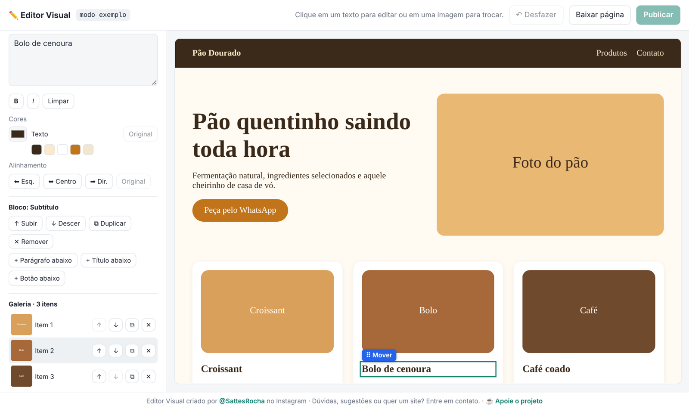
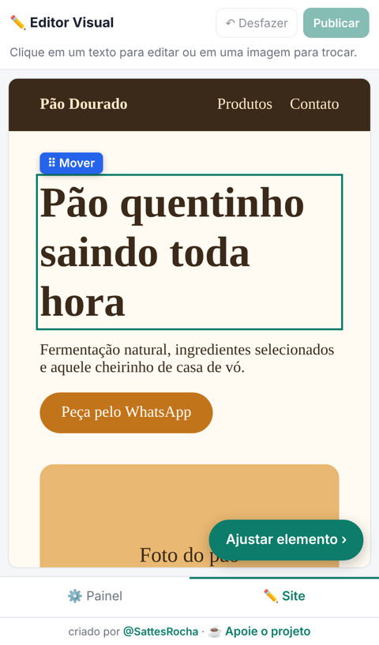

# ✏️ Editor Visual para sites no Netlify

Edite o seu site hospedado no Netlify **como no WordPress**: clique nos textos para reescrever, clique nas imagens para trocar e aperte **Publicar**. Sem programar e sem precisar instalar nada.

### 👉 [Abrir o Editor Visual](https://sattesrocha.github.io/editor-visual-netlify/)

## Como usar

1. Abra o **[editor](https://sattesrocha.github.io/editor-visual-netlify/)**.
2. No Netlify, gere um **token de acesso pessoal** em [User settings → Applications → Personal access tokens](https://app.netlify.com/user/applications#personal-access-tokens). Se puder, escolha uma data de validade.
3. Cole o token no editor e clique em **Conectar**.
4. Escolha o site e a página, edite e clique em **Publicar**.

Quer só experimentar? Clique em **Testar com exemplo**. Não precisa de conta.

## O que dá para fazer

- **Textos:** editar clicando no site ou pelo campo no painel, com negrito, itálico, cor e alinhamento.
- **Imagens:** trocar fotos, editar o texto alternativo (SEO) e trocar imagens de fundo.
- **Galerias e carrosséis:** adicionar, remover, duplicar e reordenar fotos.
- **Seções:** reordenar arrastando, duplicar e remover.
- **Arrastar e soltar** qualquer elemento para outro lugar da página.
- **Inserir** títulos, textos, botões, imagens e divisores em qualquer ponto.
- **Cores** de textos, botões e blocos, com atalhos para as cores que o site já usa.
- **SEO:** título e descrição de cada página.
- **Desfazer** (Ctrl+Z) e **rascunho automático** no navegador: feche e volte depois sem perder nada e sem gastar créditos.
- **Versões publicadas:** volte a qualquer versão anterior com um clique.

## No celular

O editor também funciona no celular. As abas **⚙️ Painel** e **✏️ Site**, embaixo da tela, alternam entre as opções e o site. Toque em um elemento do site e use **Ajustar elemento** para abrir as opções dele.

### Instale como aplicativo

O editor pode virar um app, com ícone próprio e janela sem barra de endereço:

- **Chrome ou Edge (computador):** clique em **⬇ Instalar app**, no topo do editor, ou no ícone de instalar na barra de endereço.
- **Android:** no Chrome, menu **⋮ → Instalar app** (ou "Adicionar à tela inicial").
- **iPhone:** no Safari, **Compartilhar → Adicionar à Tela de Início**.

Depois de instalado, o editor abre pelo ícone e se atualiza sozinho.

 

## ⚠️ Antes de publicar

- **Cada publicação gasta créditos do Netlify**, cerca de 15 por deploy. No plano gratuito são 300 créditos por mês. Junte as alterações e publique uma vez só.
- **Restaurar** uma versão anterior não gasta créditos.
- **Sites ligados a um repositório Git:** o próximo build automático do repositório pode sobrescrever o que for publicado pelo editor. O editor funciona melhor em sites enviados manualmente (arrastando a pasta no Netlify).
- **Sites que usam funções do Netlify** (formulários avançados, integrações): o editor avisa antes de publicar, porque essas funções podem ficar de fora da versão publicada.
- Funciona melhor com sites em **HTML**. Em sites gerados por React, Vue ou Next.js, parte do conteúdo pode não ser editável.
- Durante a edição, os scripts do site ficam desligados por segurança. Mapas, vídeos e outros conteúdos embutidos aparecem em branco **só no editor**. No site publicado, tudo continua funcionando.

Valores de créditos conforme a [documentação do Netlify](https://docs.netlify.com/manage/accounts-and-billing/billing/billing-for-credit-based-plans/how-credits-work/) em outubro de 2026. Podem mudar.

## 🔒 Privacidade e segurança

- O editor conversa direto com a API do Netlify, sem passar por nenhum servidor intermediário. Seu token não é enviado para nenhum outro lugar.
- O token só fica salvo se você marcar **Lembrar neste navegador**, e por no máximo 30 dias. Não marque em computador compartilhado.
- O botão **Sair e apagar dados** remove o token e os rascunhos do navegador.
- O token do Netlify dá acesso à sua conta inteira. Não compartilhe com ninguém e revogue no painel do Netlify quando não precisar mais.

## Autor

Criado por **[@SattesRocha](https://www.instagram.com/SattesRocha/)**. Dúvidas, sugestões ou quer um site? Entre em contato pelo Instagram.

### ☕ Apoie o projeto

Gostou? Qualquer valor ajuda a manter e melhorar a ferramenta. O QR Code Pix está no botão **Apoie o projeto**, no rodapé do editor.

Chave Pix (aleatória): `7daae93e-edd0-4890-a51a-590fe02d91d1`

---

© 2026 SattesRocha. Todos os direitos reservados.
